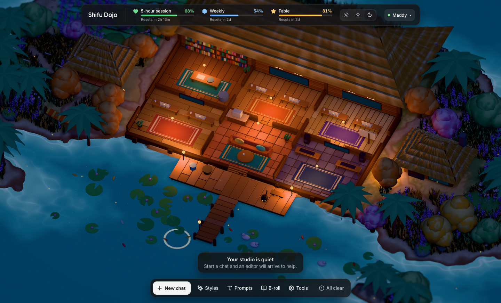
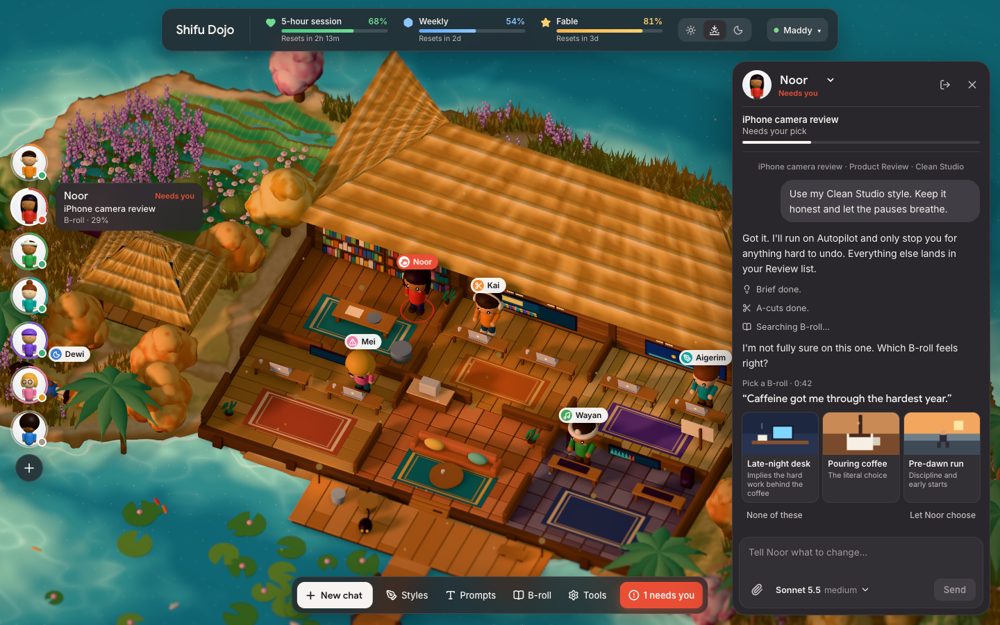

<!--
  Shifu Dojo: an open-source AI video editing studio for Mac, powered by Claude.
  Raw footage in, finished edit out: cuts, B-roll, captions, motion graphics and sound.
  Runs locally with your own Claude login.
-->



<h1 align="center">Shifu Dojo</h1>

<p align="center">
  <b>An open-source AI video editing studio for Mac, powered by <a href="https://claude.com/product/claude-code">Claude</a>.</b><br />
  Drop in raw footage, say what you want, and get a finished edit back.
</p>

<p align="center">
  <a href="#install">Install</a> ·
  <a href="#see-it-in-action">Demo</a> ·
  <a href="#real-results">Results</a> ·
  <a href="#meet-the-crew">Crew</a> ·
  <a href="#how-an-edit-works">How it works</a> ·
  <a href="#whats-inside">What's inside</a> ·
  <a href="#faq">FAQ</a>
</p>

<p align="center">
  
  <a href="https://claude.com/product/claude-code"></a>
  <a href="engine/test/"></a>
</p>

**Shifu Dojo turns raw footage into a finished video.** Give it a talking-head recording and a one-line brief, and Claude edits it the way a working editor would. You get back an MP4, captions as an SRT, and a project file you can open in DaVinci Resolve.

It does the jobs an editor does:

- **A-cuts.** Removes retakes, false starts, fillers and dead air, and keeps the pauses that carry weight.
- **B-roll.** Searches your own footage library by meaning, not just keywords, and picks cutaways by association.
- **Captions.** Word-timed captions with animated reveals and emphasis on the words that matter, kept clear of the speaker's face.
- **Motion graphics.** A second agent builds animated graphics for the moments a picture explains better than a face.
- **Sound.** Effects on the words, music that ducks under speech, and a listening tool so Claude can check audio it can't hear.
- **Style.** Show it one reference video and it learns that editor's pacing, cuts, captions, motion and effects, then recreates them on anyone.

Each chat is one editor, and several can work at the same time. Everything runs on your Mac with your own Claude login. Transcripts, background removal and frame analysis use Apple's built-in frameworks instead of paid APIs.

## See it in action

Every editor is a character in the studio. Pick one to talk to it, or start a new chat and an editor walks in:



The editor only stops when a choice is genuinely yours, such as which B-roll fits a line. Everything else runs on autopilot and lands in a review list:



> These screenshots are from an early build with sample data.

## Real results

In the first full test, Claude learned a style from a short reference reel, then edited a different speaker's clip in that style. Pace was measured the same way on both:

| | Reference | Shifu Dojo's edit |
|---|---|---|
| **Typical gap between new things on screen** | 0.64 s | 0.57 s |
| **Longest stretch with nothing new** | 2.67 s | 2.40 s |
| **Frozen frames** | 7% | 0% |

The edit passed every quality check: resolution, frame rate, loudness and duration. Learning the style took about eight and a half minutes.

> One real test so far. Results will vary with footage and style.

## Meet the crew



Every chat is a **main editor**. It does the whole edit itself, moving through the studio one stage at a time. When a moment needs a motion graphic, it writes a brief and hands it to a **Motion agent**, which works in the background with the reference in hand while the editor carries on.

That's the whole team: one editor and one Motion agent per chat. No other agents start, so a chat never fans out into dozens of processes eating your plan.

<details>
<summary><b>All 12 skills</b></summary>
<br />

| Skill | What it does | From |
|---|---|---|
| `editor` | The five-stage edit, start to finish | Shifu Dojo |
| `reference-style` | Reads a reference's pacing, editing, audio, captions, positioning, motion, animation, effects and transitions, and recreates them | Shifu Dojo |
| `broll-director` | Chooses B-roll by association, the way an editor does | Shifu Dojo |
| `motion-artist` | How the Motion agent designs premium motion graphics from a brief | Shifu Dojo |
| `motion-broll` | Motion-graphic B-roll timed to the speaker's words | [Barty-Bart/motion-graphics](https://github.com/Barty-Bart/motion-graphics) |
| `explainer-default` | Clean 45 to 90 second product demos | Barty-Bart/motion-graphics |
| `explainer-engaging` | 10 to 30 second continuous-shot explainers | Barty-Bart/motion-graphics |
| `explainer-high-energy` | 12 to 20 second beat-locked promos | Barty-Bart/motion-graphics |
| `object-separation` | Separates a person or product from the background with SAM 2 | Barty-Bart/motion-graphics |
| `sound-effects` | A measured sound pass on the beat | Barty-Bart/motion-graphics |
| `earshot` | Lets Claude hear audio and judge it | [Leonxlnx/earshot](https://github.com/Leonxlnx/earshot) |
| `real-sound` | Realistic soundtracks from real recordings | Leonxlnx/earshot |

</details>

**Built for:**

- **Creators** who film themselves and want the edit done by morning, not in a weekend.
- **Content teams** that turn out talking-head videos for YouTube and Instagram every week and want one consistent look.
- **Editors** who want a strong first cut to finish by hand, with a project file that opens in Resolve.

## How an edit works

1. **Brief it.** Upload your footage, pick one of your styles if you like, and say what you want in a sentence.
2. **The editor works through five stages.** A-cuts, B-roll, captions and animation, motion graphics, then sound. Every change goes into one edit document anchored to the words, so a later change never breaks an earlier one.
3. **It checks its own work.** It renders a preview, looks at the frames that matter, and compares the pace with the reference before the final render.
4. **You get the files.** An MP4, an SRT and an FCPXML, plus a short summary of the calls worth a second look. Ask for changes in plain words, or bring back any earlier version.

Only three things ever stop an edit for approval: publishing, paying, and deleting source footage.

<details>
<summary><b>What a style learns</b></summary>
<br />

Give Shifu Dojo a reference video and it measures the edit on your Mac first: every cut and transition, camera moves and punch-ins, pace, caption placement, music and effects. Claude then studies frames, frame sequences and the transcript, with those measurements as evidence, and writes a style card covering eight areas:

| Area | Examples |
|---|---|
| Pacing | How often something new happens, how long a shot may sit |
| Editing | Jump cuts, B-roll rhythm, what gets cut |
| Audio | Music beds, hits, how sound follows the picture |
| Captions | Font, size, reveal, per-word emphasis |
| Positioning | Where faces, words and graphics sit |
| Motion | Pushes, punch-ins, pans and shake |
| Animation | How designed things enter, settle and leave |
| Effects and transitions | The few tricks the style really uses |

Every rule cites the moments it came from, and you approve the card before it's used. Colour grading is left out for now.

The same study also fills the **Motion library**: each animation in the reference is saved as a short loop with a spec the Motion agent can rebuild on anyone's video, along with the caption preset and one thumbnail frame. Animations are sorted by what they do rather than how they look, as in Jason Murray's taxonomy of visuals:

| Level | Question | Examples |
|---|---|---|
| Operation | What job does it do? | Emphasize, Explain, Compare, Prove, Reveal, Sequence, Move on, Reset attention |
| Domain | Which lever does it pull? | Type, Camera, Layout, Depth, Graphic, Time |
| Technique | What's the move? | Word pop, Push-in, Split screen, Behind-subject plate, Card builds row by row |
| Execution | A real example | The saved loop, with its source and timing |

When an editor reaches a graphic, it asks the library for three to five options that each use a different technique, and you can pick from the loops in chat. When Claude finds a technique that isn't on the list, it proposes it and an admin approves it.

</details>

## What's inside

<details>
<summary><b>Editing</b></summary>
<ul>
<li>One word-anchored edit document with versions and restore</li>
<li>Take analysis: repeated takes, false starts, fillers, dead air and pauses worth keeping</li>
<li>Camera moves, punch-ins, transitions, solid cards, effects and placed overlays</li>
<li>Animated captions with per-word font, size and colour</li>
<li>Sound effects on words, and music that ducks under speech</li>
<li>Pace check against the reference, and a quality check on every final render</li>
</ul>
</details>
<details>
<summary><b>B-roll library</b></summary>
<ul>
<li>Upload or import from Google Drive, with duplicates caught by hash</li>
<li>Shot detection, colour, motion, sharpness, on-screen text and faces, all measured locally</li>
<li>Claude writes a short meaning card for each clip, in batches you control</li>
<li>Search by meaning, keyword and filters together, and it learns from your picks</li>
<li>Each shot also records the job it does (literal, proof, metaphor, contrast, list or texture) and where it fits (full screen, half of a split, a small window, behind the speaker)</li>
</ul>
</details>
<details>
<summary><b>Native Mac tools</b> (Swift, no paid API)</summary>
<ul>
<li>Word-timed transcripts with Apple SpeechAnalyzer</li>
<li>Background removal with Apple Vision</li>
<li>Frame analysis: on-screen text, faces and saliency</li>
<li>Camera motion measurement, depth, parallax and 3D camera tracking</li>
<li>Animated caption rendering</li>
</ul>
</details>
<details>
<summary><b>Accounts and limits</b></summary>
<ul>
<li>Each Claude account signs in through Claude's own login page. Shifu Dojo never reads or stores a token.</li>
<li>Your real 5-hour, weekly and per-model limits, shown for every account</li>
<li>Choose the account, model and effort for each chat</li>
</ul>
</details>
<details>
<summary><b>Tool packs</b> (install from Settings)</summary>
<ul>
<li><b>Earshot</b>: lets Claude hear audio and video (about 2.3 GB)</li>
<li><b>Motion renderer</b>: renders motion graphics with Playwright and Chromium (about 300 MB)</li>
<li><b>Depth</b>: Depth Anything V2 Small for parallax and 3D camera moves (about 50 MB)</li>
<li><b>Camera tracking</b>: COLMAP solves the real camera path (about 1 GB through Homebrew)</li>
</ul>
</details>

## Install

You need:

- macOS 26 or newer on Apple Silicon (word-timed transcripts use SpeechAnalyzer, which starts in macOS 26)
- [Claude Code](https://code.claude.com), signed in
- ffmpeg and Node.js: `brew install ffmpeg node`
- Xcode or the Xcode Command Line Tools, to build the Swift parts

Then build the app:

```bash
git clone https://github.com/MadhavendraSinghShaktawat/editMaxing.git
cd editMaxing
npm install
./scripts/build-mac.sh
open build/ShifuDojo.dmg
```

Drag **Shifu Dojo** to Applications and open it. The app starts its engine when it opens and stops it when it quits. **Studio > Open in Browser** opens the same studio in a browser window, already signed in.

The Earshot and Motion packs need Python 3.10 or newer: `brew install python@3.13`. Install packs in **Settings > Tool packs**.

<details>
<summary><b>Run from source</b></summary>
<br />

```bash
npm install
swift build -c release --package-path mac --product dojo-native
npm run build
npm run engine
```

Open the address the engine prints; it includes this Mac's sign-in link. For frontend work, leave the engine running and use `npm run dev`. Add `?demo` to the address to see a sample crew with no engine data.

| Command | What it does |
|---|---|
| `npm run engine` | Starts the local engine on port 51791 |
| `npm test` | Runs the engine tests |
| `npx tsc -p engine/tsconfig.json` | Type-checks the engine |

</details>

<details>
<summary><b>Optional keys</b></summary>
<br />

Add these in **Settings**. They go to the macOS Keychain and are never shown again.

| Key | Used for | Needed? |
|---|---|---|
| OpenRouter | Embeddings for B-roll meaning search. Only text is sent. | For meaning search. Keyword search works without it. |
| Google | Listing Google Drive folders | Only for folder links. File links work without it. |
| Epidemic Sound | Music and effects | Optional. The bundled CC0 effects are always free. |
| Scrape Creators | Paste a TikTok, Instagram, Facebook, X, Threads, Reddit, Snapchat, Pinterest, Bluesky, Truth Social, Twitch, Kick or Rumble link as your footage, a reference, or a new style. Optionally gives editors its lookup tools in chat. Each person adds their own key. | Optional. About 1 credit a link. YouTube and LinkedIn links aren't supported, because Scrape Creators returns their details but not the video. |

</details>

**Your first edit:** click **New chat**, drop in a video, and type something like:

```text
Cut this into a 60-second Instagram reel. Keep it punchy, and let the pause after the big claim breathe.
```

## FAQ

<details>
<summary><b>What is Shifu Dojo?</b></summary>
<br />

An open-source video editing studio where Claude does the editing. It runs on your Mac, uses your own Claude login, and edits talking-head footage from raw recording to finished video: cuts, B-roll, captions, motion graphics and sound.

</details>

<details>
<summary><b>What does it cost?</b></summary>
<br />

Shifu Dojo itself is free. Each chat runs on your own Claude plan through Claude Code, so edits use your plan's limits, and the studio shows how much you have left. A full edit with motion graphics uses noticeably more than a quick cut.

</details>

<details>
<summary><b>Does my footage leave my Mac?</b></summary>
<br />

Your video files stay on your Mac, and transcription, background removal and frame analysis run locally. Claude sees what the editor shows it, such as transcripts and still frames, the same as anything else you work on in Claude Code. Optional keys send only what's listed in the table above.

</details>

<details>
<summary><b>Can it edit like a specific creator?</b></summary>
<br />

Yes. Attach a reference video and Shifu Dojo learns its style across eight areas, then applies it to your footage. You approve the style before it's used. Styles you're proud of can be shared with everyone through the [shared styles folder](library/styles/README.md).

</details>

<details>
<summary><b>Can I finish the edit in Resolve or Premiere?</b></summary>
<br />

Every final render comes with an FCPXML. Today it carries the cuts and B-roll; camera moves, transitions, cards and captions are only in the rendered MP4. The SRT gives you the captions as text.

</details>

<details>
<summary><b>Does it work on Windows or Linux?</b></summary>
<br />

Not yet. Transcription, background removal and frame analysis are built on Apple frameworks, so it needs macOS 26 on Apple Silicon.

</details>

<details>
<summary><b>Good to know: limits</b></summary>
<br />

- **Signing.** The app is ad-hoc signed, so it runs on the Mac that built it. Sharing a build with others needs an Apple Developer ID and notarization.
- **Languages.** English transcription is tested. Hindi runs, but its accuracy on real speech hasn't been checked.
- **Not yet supported.** Colour grading, and speed ramps on the main footage.
- **One Motion agent per chat**, so motion graphics are built one batch at a time.

</details>

## Shared styles

Shifu Dojo comes with no built-in styles. You make your own from a reference video, and the best ones are shared in [`library/styles/`](library/styles/README.md), where everyone's Styles board picks them up. That page explains how to send yours.

## Project layout

<details>
<summary><b>Where things live</b></summary>
<br />

| Path | Role |
|---|---|
| `engine/src/` | Local TypeScript engine: accounts, chats, jobs, tools, library, styles, render |
| `engine/src/claude/` | Accounts, chat runtime and permission policy |
| `engine/test/` | Engine tests |
| `library/plugin/` | The Claude Code plugin with every skill. See `NOTICE.md` for credits. |
| `library/styles/` | Shared styles |
| `mac/Sources/DojoNative/` | Swift tools: transcription, background removal, frame analysis, captions, camera motion, depth, parallax |
| `mac/Sources/ShifuDojo/` | The Mac app that runs the engine and hosts the studio |
| `src/` | The studio: 3D world, characters, chat, decision cards and boards |
| `assets/readme/` | These banners, and `make.py`, which draws them |

[BACKEND.md](BACKEND.md) lists what's built and what still needs a real-world test.

</details>

## Contributing

Pull requests are welcome. Run `npm test` and `npx tsc -p engine/tsconfig.json` before you open one, and say what you tested in the description. To share a style, follow the [shared styles guide](library/styles/README.md).

## Credits

Built by **Maddy** at Social Shifu, with Claude.

The motion-graphics skills come from [Barty-Bart/motion-graphics](https://github.com/Barty-Bart/motion-graphics) and the listening tools from [Leonxlnx/earshot](https://github.com/Leonxlnx/earshot), both under the MIT licence. See [`library/plugin/NOTICE.md`](library/plugin/NOTICE.md). Banner type is [Geist](https://vercel.com/font), under the SIL Open Font License.


